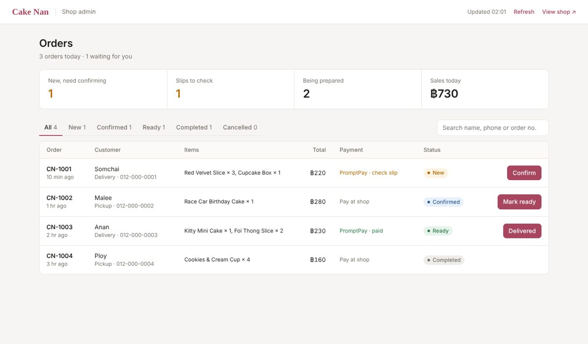

# Cake Nan

An online ordering website I built for Cake Nan, a small bakery in Nan, Thailand.

Customers browse the menu, add cakes to a cart, and choose delivery or store pickup. They can pay with a PromptPay QR code or cash. The shop owner manages every order from an admin dashboard.


## What it does

- **Ordering:** menu with search and category tabs, a cart, and checkout
- **Payments:** generates a PromptPay QR code for the exact order total and lets customers upload their payment slip
- **Admin dashboard:** shows daily sales and new orders, lets the owner check payment slips and move each order from new to completed
- **Security:** the admin area needs a login, prices are checked on the server, and uploads are validated



## Built with

Node.js, Express, HTML, CSS and JavaScript

## Run it locally

```bash
npm install
cp .env.example .env   # set your admin password
npm start
```

Then open http://localhost:3000. The dashboard is at `/admin`.
